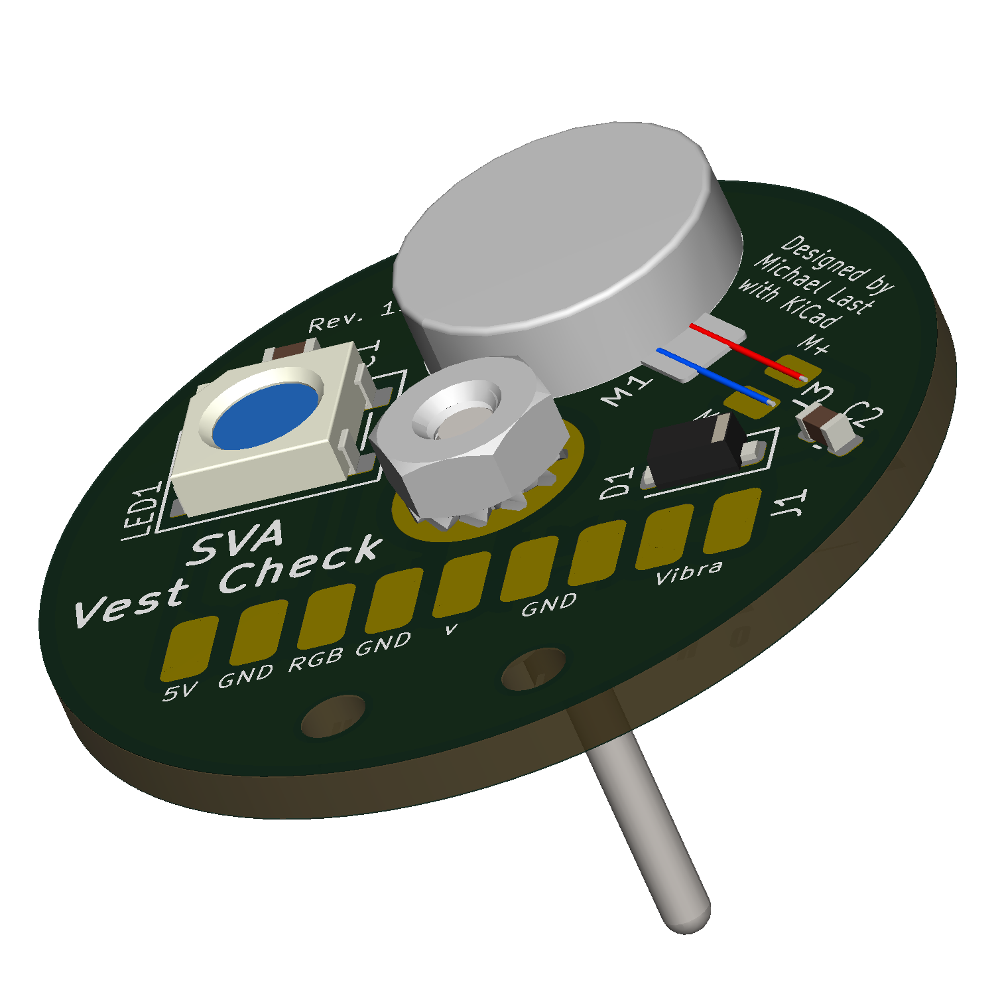
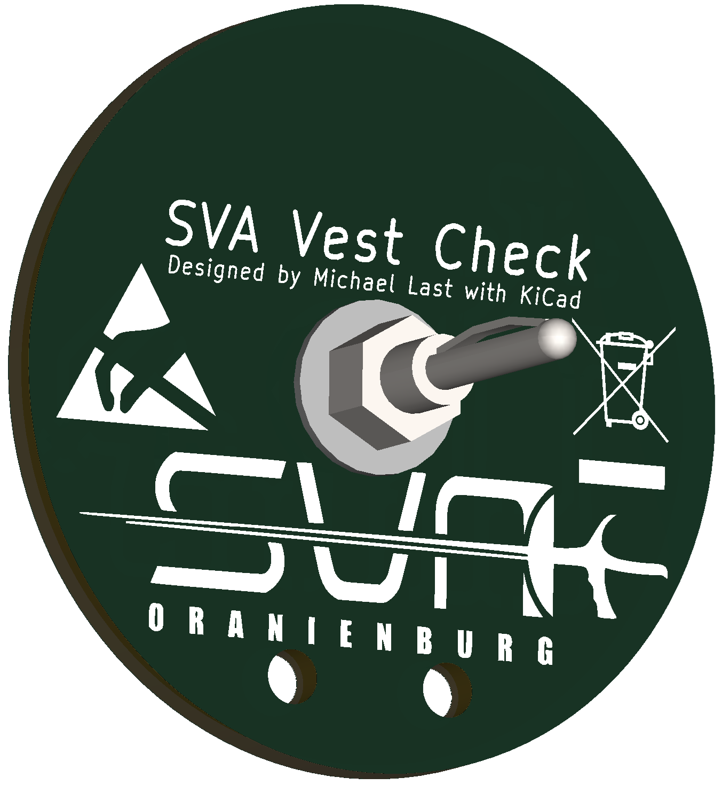

# Westen-Prüfstift-Adapterplatine

Diese Adapterplatine ergänzt den SVA-Fencing-Tester um den Anschluss für den Westen-Prüfstift. Sie ist für die zweite Vest-Test-Variante vorgesehen und stellt die Verbindung zwischen Prüfstift und dem Vest-Test-Anschluss des Testers her.

| Ansicht | Datei |
| --- | --- |
| Oberseite / Bestückungsseite | [vest-probe-adapter-top.png](./vest-probe-adapter-top.png) |
| Unterseite | [vest-probe-adapter-bottom.png](./vest-probe-adapter-bottom.png) |

Die Renderings dienen der visuellen Dokumentation und Identifikation der Baugruppe. Sie enthalten keine editierbaren PCB-, Schaltplan- oder Fertigungsdaten.

